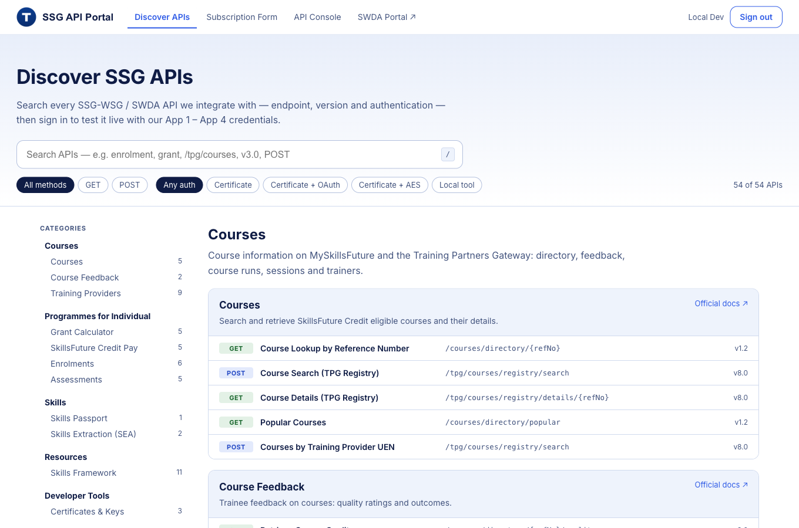

<div align="center">

# SSG API Portal

[](https://nodejs.org/)
[](https://react.dev/)
[](https://www.typescriptlang.org/)
[](https://expressjs.com/)
[](https://vite.dev/)
[](https://coolify.io/)
[](LICENSE)

**SSG API / SWDA API reference with curl, Python and JavaScript examples, TPG process guides, and a live API console**

[Report Bug](https://github.com/alfredang/ssg-api-portal/issues) · [Request Feature](https://github.com/alfredang/ssg-api-portal/issues)

</div>

## Screenshot



**Live:** https://ssgapi.tertiaryinfotech.com/

## About

SSG API Portal is the public reference for the SkillsFuture Singapore (SSG-WSG / SWDA) APIs that Tertiary Infotech
Academy integrates with, plus a signed-in console for testing them live. Anyone can read the reference; only
allow-listed staff can run calls with the company's SSG apps.

### Key Features

| Feature | Description |
|---------|-------------|
| **API reference** | One page per API (55 entries): endpoint, version, auth, request table, example body, and runnable **curl / Python / JavaScript** examples with certificate, OAuth and AES variants |
| **Search and navigation** | Sidebar with filter, `/` or `Ctrl/Cmd-K` search palette, breadcrumbs, previous / next |
| **Getting started and guides** | Auth and AES walkthrough; creating the certificate and encryption keys on **macOS and Windows**; the **SSG API subscription process** |
| **TPG process** | The 13 Training Partners Gateway steps as a journey map; every guide rendered as HTML with self-drawn visuals (process flow, buttons, schematic screens) |
| **Subscription form** | The API Subscription Form for SSG-WSG APIs, filled in online and exported to Word |
| **Services and contact** | SSG API integration services page with a checklist download, and a contact page; enquiries are stored for staff |
| **API console (sign-in)** | Live test pages for courses, feedback, course runs, attendance, grants, SkillsFuture Credit Pay, enrolments, assessments, Skills Passport, SEA and Skills Framework, switchable between **App 1 – App 4** |
| **Defaults and known issues** | Per-user default values that fill every form; a known-issues dashboard |
| **SEO** | Real URLs, per-page titles and descriptions sent by the server, sitemap.xml, robots.txt |
| **Mobile friendly** | Menu, API drawer and console drawer on small screens |

## Tech Stack

| Category | Technology |
|----------|------------|
| **Frontend** | React 19, TypeScript 5.9, Vite 7 |
| **Backend** | Express 5, Node.js 22 |
| **Defaults Storage** | File-based JSON store (per-user form defaults) |
| **App Auth** | Google OAuth (social login) via Passport + cookie sessions — disabled on localhost |
| **SSG API Auth** | OAuth 2.0 (client credentials) + mTLS (client certificates) |
| **APIs** | SSG-WSG Course, Grant, SF Credit, Enrolment, Assessment, Skills Passport, SEA, Skills Framework APIs |
| **Deployment** | Docker on Coolify (single container, no database) |
| **HTTP Client** | Axios (frontend), native `https` (backend mTLS) |

## Architecture

```
┌──────────────────────────────────────────────────────────────────┐
│                        Browser (React)                          │
│                     Vite + TypeScript SPA                       │
└───────────────────────────┬──────────────────────────────────────┘
                            │
                    /api/courses/*
                            │
┌───────────────────────────▼──────────────────────────────────────┐
│                     Express Proxy Server                         │
│                                                                  │
│  ┌─────────────────────┐    ┌──────────────────────────────────┐ │
│  │   OAuth Module       │    │   mTLS Module                    │ │
│  │   (client_credentials│    │   (client certificate + key)     │ │
│  │    grant + cache)    │    │                                  │ │
│  └──────────┬──────────┘    └──────────────┬───────────────────┘ │
└─────────────┼──────────────────────────────┼─────────────────────┘
              │                              │
              ▼                              ▼
┌─────────────────────────┐  ┌──────────────────────────────────┐
│  public-api.ssg-wsg.sg  │  │       api.ssg-wsg.sg             │
│  Course Directory v1.2  │  │  Course Registry/Search v8.0     │
│  (OAuth Bearer Token)   │  │  (mTLS Certificate Auth)         │
└─────────────────────────┘  └──────────────────────────────────┘
```

## Project Structure

```
ssg-api-portal/
├── server/
│   ├── index.js              # Express app: auth, enquiries, SSG proxy, per-URL SEO tags, static files
│   ├── auth.js               # Google OAuth, cookie sessions, email allow-list, local bypass
│   ├── proxy.js              # SSG API proxy routes (mTLS certificate + OAuth fallback, AES)
│   ├── oauth.js              # SSG OAuth token fetch + cache
│   ├── leads.js              # POST /lead (public enquiries), GET /api/leads (staff)
│   ├── defaults.js           # Per-user defaults API
│   └── store.js              # File-based defaults store (JSON)
├── client/
│   ├── index.html            # HTML shell with the <!--seo--> block the server fills in
│   ├── scripts/gen-seo.mts   # Build step: dist/seo.json, sitemap.xml, robots.txt
│   ├── public/tpg-process/   # The original SSG TPGateway guides (PDF downloads)
│   └── src/
│       ├── main.tsx          # Routes: public pages and the signed-in console
│       ├── router.ts         # Path router (History API), legacy #/ redirects
│       ├── seo.ts            # Title, description and keywords of every page
│       ├── catalog.ts        # Every API: path, version, auth, verified / added dates
│       ├── apiSpecs.ts       # Parameters, example bodies, curl / Python / JS generator
│       ├── prefs.ts          # Remembered example language and fill-in values
│       ├── tpgSteps.ts       # The 13 TPG steps and 5 phases
│       ├── tpgTypes.ts       # Content model of a TPG guide
│       ├── tpgGuidesA.ts     # Guides 1-6 as structured content
│       ├── tpgGuidesB.ts     # Guides 7-13 as structured content
│       ├── App.tsx           # The API console (signed-in)
│       ├── App.css           # All styles (Tertiary HRMS light design tokens)
│       ├── api/courseApi.ts  # Console API client (sends x-ssg-app)
│       └── components/
│           ├── Shell.tsx          # Top bar, search palette, API sidebar, footer
│           ├── Docs.tsx           # Home, category, API and Getting started pages
│           ├── ApiSpec.tsx        # Request spec, code panel, fill-in values
│           ├── Guides.tsx         # Keys guide and subscription-process guide
│           ├── TpgProcess.tsx     # TPG journey map and step page
│           ├── TpgGuide.tsx       # Renders a guide: flow, steps, schematic screens
│           ├── Marketing.tsx      # Contact page, services page, enquiry form
│           ├── SubscriptionForm.tsx
│           ├── LoginPage.tsx      # Two-column sign-in
│           ├── LeadsPage.tsx      # Console: enquiries
│           └── …                  # Console result cards and forms
├── default-values.csv        # Default form values (UEN, Course Ref, etc.)
├── Dockerfile                # Multi-stage build for Coolify deployment
├── package.json
└── .env.example              # Environment variable template
```

## Getting Started

### Prerequisites

- [Node.js](https://nodejs.org/) 18+
- SSG Developer Portal account with OAuth credentials ([register here](https://developer.ssg-wsg.gov.sg))
- mTLS client certificate and private key (for Course Search API)

### Installation

```bash
# Clone the repository
git clone https://github.com/alfredang/ssg-api-portal.git
cd ssg-api-portal

# Install dependencies
npm install
cd client && npm install && cd ..

# Configure environment
cp .env.example .env
```

Edit `.env` with your SSG credentials:

```env
# OAuth Authentication (public-api.ssg-wsg.sg)
SSG_API_BASE_URL=https://public-api.ssg-wsg.sg
SSG_CLIENT_ID=your_client_id
SSG_CLIENT_SECRET=your_client_secret

# mTLS Authentication (api.ssg-wsg.sg)
SSG_CERT_API_BASE_URL=https://api.ssg-wsg.sg
CERT_1_NAME=Skilleto
CERT_1_CERT_FILE=./server/.cert/ssg-app1-cert.pem
CERT_1_KEY_FILE=./server/.cert/ssg-app1-key.pem
```

### Running Locally

```bash
npm run dev
```

Starts Express on http://localhost:3001 and Vite on http://localhost:5173.

### Production Build

```bash
npm run build
npm start
```

Builds the React app and serves everything from Express on port 3001.

## Deployment (Coolify)

The app ships as a single Docker image: a multi-stage [Dockerfile](Dockerfile) builds the
React client and serves it from the Express server alongside the API proxy.

1. **Create an Application** from this Git repo. Coolify auto-detects the `Dockerfile`.
2. **Add a persistent volume** mounted at `/app/server/data` so per-user defaults and
   website enquiries (`leads.jsonl`) survive redeploys. No database is required.
3. **Set environment variables** (below), then deploy. The container listens on port `3001`.
4. **Configure Google OAuth**: in the [Google Cloud Console](https://console.cloud.google.com/apis/credentials),
   add `https://your-domain.com/auth/google/callback` as an Authorized redirect URI.

**Auth behavior:** localhost (`NODE_ENV` unset) requires **no login**; the remote
deployment (`NODE_ENV=production`) requires **Google sign-in**. Override with `AUTH_DISABLED`.

**Storage:** per-user form defaults are saved to a JSON file under `DATA_DIR`
(default `/app/server/data`) — no Firestore, no database.

**Required environment variables on Coolify:**

| Variable | Description |
|----------|-------------|
| `NODE_ENV` | Set to `production` |
| `DATA_DIR` | Defaults and enquiries location (default `/app/server/data`; back with a volume) |
| `ALLOWED_EMAIL_DOMAINS` / `ALLOWED_EMAILS` | Who may sign in (optional; defaults to the company domains) |
| `LEAD_WEBHOOK_URL` | Optional: post each new enquiry to a chat or CRM webhook |
| `SESSION_SECRET` | Long random string for signing session cookies |
| `GOOGLE_CLIENT_ID` | Google OAuth 2.0 client ID |
| `GOOGLE_CLIENT_SECRET` | Google OAuth 2.0 client secret |
| `GOOGLE_CALLBACK_URL` | `https://your-domain.com/auth/google/callback` |
| `SSG_CLIENT_ID` | SSG OAuth client ID |
| `SSG_CLIENT_SECRET` | SSG OAuth client secret |
| `SSG_API_BASE_URL` | Public API base URL |
| `SSG_CERT_API_BASE_URL` | Certificate API base URL |
| `CERT_1_NAME` | Display name for certificate set 1 |
| `CERT_1_CERT` / `CERT_1_KEY` / `CERT_1_ENCRYPTION_KEY` | Cert set 1 — inline PEM **or** use the `*_FILE` variants below |

### Certificates & secrets (never published)

The SSG mTLS client certificates and private keys are **secrets**. They are
**never committed to git** — `.env`, `server/.cert/`, and all `*.pem` / `*.key`
files are gitignored, the `.dockerignore` keeps them out of the image, and no
HTTP endpoint serves cert/key material. Provide them at runtime one of two ways:

**Option A — Coolify persistent storage (recommended).** Mount a Coolify volume
(e.g. at `/app/server/.cert`), upload the PEM files there, and point each cert
set at the files. PEM files keep real newlines, so there is no `\n`-escaping pain:

```
CERT_1_NAME=Skilleto
CERT_1_CERT_FILE=/app/server/.cert/ssg-app1-cert.pem
CERT_1_KEY_FILE=/app/server/.cert/ssg-app1-key.pem
CERT_1_ENCRYPTION_KEY=<32-char-key>     # or CERT_1_ENCRYPTION_KEY_FILE
```

**Option B — environment variables.** Paste the full PEM into `CERT_1_CERT` /
`CERT_1_KEY` as Coolify **secret** env vars. Multiline values with literal `\n`
are normalised automatically. Mark them as secrets so they aren't shown in logs.

Up to three cert sets are supported (`CERT_1_*`, `CERT_2_*`, `CERT_3_*`); each
`*_FILE` path takes precedence over its inline value.

### Public catalogue, private console

| Route | Who | What |
|---|---|---|
| `/` | Public | **API Reference** home: base URLs, three "start here" examples, products and categories. |
| `/docs/<slug>` | Public | **One page per API**: request spec on the left, a sticky curl / Python / JavaScript example on the right (Certificate / OAuth toggle, Copy, Download), New / Verified badges, TPG steps, link to the console. |
| `/category/<group>` | Public | The APIs of one category. |
| `/start` | Public | **Getting started**: app setup, base URLs, mTLS call, OAuth token, AES, status codes. |
| `/guides/create-keys` | Public | **Create the certificate and encryption keys** on macOS and Windows. |
| `/guides/api-subscription` | Public | **SSG API subscription process**, eight stages from Developer Portal app to production. |
| `/tpg-process[/<slug>]` | Public | **TPG Process**: journey map of the 13 TPGateway steps; each step is rendered as HTML with self-drawn visuals (flow, buttons, schematic screens). Content: `client/src/tpgGuidesA.ts` / `tpgGuidesB.ts` (model in `tpgTypes.ts`, renderer `components/TpgGuide.tsx`); the original PDFs stay in `client/public/tpg-process/` as downloads. |
| `/subscription-form` | Public | Online **API Subscription Form**; exports a filled Word file. Nothing is sent to the server. |
| `/ssg-api-services` | Public | **Services / lead magnet** page: enquiry form unlocks the SSG API Integration Checklist download. |
| `/contact` | Public | **Contact us**: address, phone, WhatsApp, email and an enquiry form. |
| `/console/<page>` | Signed in | **API Console**: test each API live with App 1 – App 4; includes **Enquiries** (leads). |

**Routing and SEO.** Real paths (History API, `client/src/router.ts`); old `#/…` links redirect in the browser and
numbered TPG URLs 301 to their keyword URL. `client/src/seo.ts` is the single source of each page's title,
description and keywords (targets: SSG API, SWDA API, TPG process, TPG claim process, SWDA enrolment process).
`npm run build` runs `scripts/gen-seo.mts`, which writes `dist/seo.json`, `sitemap.xml` and `robots.txt`; the server
injects the tags into the HTML per URL, and unknown paths return 404.

**Enquiries.** `POST /lead` (public, honeypot + rate limit) appends to `DATA_DIR/leads.jsonl` and, if
`LEAD_WEBHOOK_URL` is set, posts the enquiry there. Staff read them in the console under Enquiries
(`GET /api/leads`, sign-in required). No email is sent by the app.

**Sign-in.** Google accounts on `ALLOWED_EMAIL_DOMAINS` (default `tertiaryinfotech.com,tertiarycourses.com.sg`),
the named staff in `STAFF_EMAILS` (`server/auth.js`) and any `ALLOWED_EMAILS`.

**Monthly update check.** The Digital Workforce agent `ssg-api-watcher` runs on the 1st of each month and reports
new, changed or retired SSG / SWDA APIs with ready-to-paste `catalog.ts` and `apiSpecs.ts` entries. It is read-only;
apply and verify its proposals in a normal session.

Navigation: a persistent sidebar lists every API and guide with a filter; `/` or `Ctrl/Cmd-K` opens search; the
example language is chosen on any API page and remembered; "Use my own values" swaps the sample UEN, course
reference, run ID and certificate file names into every example (kept in the browser only).

Docs data: `client/src/catalog.ts` (endpoints, versions, auth, `verified` and `added` dates) and
`client/src/apiSpecs.ts` (parameters, example bodies, sample generator). Set `verified` only after the exact
generated request returned 200 from live SSG.

Every `/api/*` route that calls SSG requires a signed-in user whose email is on the allow-list
(`ALLOWED_EMAIL_DOMAINS`, default `tertiaryinfotech.com,tertiarycourses.com.sg`, plus `ALLOWED_EMAILS`).
Localhost needs no login.

### SSG App convention (same as ai-lms-tms)

| App | Header value `x-ssg-app` | Env vars | Auth | Name |
|---|---|---|---|---|
| App 1 | `app1` | `CERT_1_*` | mTLS cert + AES key | Skilleto |
| App 2 | `app2` | `CERT_2_*` | mTLS cert + AES key | TMS_1 |
| App 3 | `app3` | `CERT_3_*` | mTLS cert + AES key | TMS_3_NEW |
| App 4 | `app4` | `SSG_CLIENT_ID` / `SSG_CLIENT_SECRET` | OAuth | — |

The sidebar "SSG App" selector stores the choice and sends it as `x-ssg-app` on
every request. The legacy `x-cert-id` header and ids `1`/`2`/`3`/`oauth` are still
accepted. PEM file names follow ai-lms-tms: `ssg-appN-cert.pem` / `ssg-appN-key.pem`.

#### Populating all four "SSG App" dropdown entries

The dropdown is built at startup by `GET /api/certs`: one entry per cert set that
loads successfully, plus a fixed `App 4 (OAuth)` option. So the four entries are:

| Slot | Dropdown label | Source |
|------|----------------|--------|
| `CERT_1_*` | App 1 (Skilleto) | mTLS certificate |
| `CERT_2_*` | App 2 (TMS_1) | mTLS certificate |
| `CERT_3_*` | App 3 (TMS_3_NEW) | mTLS certificate |
| — | App 4 (OAuth) | always present; uses `SSG_CLIENT_ID`/`SSG_CLIENT_SECRET`, no cert |

If only two show, `CERT_2_*` / `CERT_3_*` were never loaded. To add them on Coolify,
mirror `CERT_1` exactly — add a **File Mount** (Configuration → Persistent Storage)
per PEM into `/app/server/.cert`, then the env vars:

```
CERT_2_NAME=TMS_1
CERT_2_CERT_FILE=/app/server/.cert/ssg-app2-cert.pem
CERT_2_KEY_FILE=/app/server/.cert/ssg-app2-key.pem
CERT_2_ENCRYPTION_KEY_FILE=/app/server/.cert/ssg-app2-encryption-key.txt   # optional (AES endpoints)
CERT_3_NAME=TMS_3_NEW
CERT_3_CERT_FILE=/app/server/.cert/ssg-app3-cert.pem
CERT_3_KEY_FILE=/app/server/.cert/ssg-app3-key.pem
```

Cert sets are read **only at process start** — you must **Redeploy** after changing
them. Verify with `GET /api/certs` (should return four entries). Check the deploy
log line `--- Checking certificate 2 ---` for the load result / skip reason.

## API Reference

This app proxies requests to SSG-WSG production APIs with cert-first + OAuth fallback:

| Endpoint | Method | Version | Description |
|----------|--------|---------|-------------|
| `/api/courses/:refNo` | GET | v1.2 | Lookup course by reference number |
| `/api/courses/details/:refNo` | GET | v8.0 | Get detailed course information |
| `/api/courses/search` | POST | v8.0 | Search courses by UEN, keyword, date range |
| `/api/training-providers/:uen/courses` | GET | v8.0 | Courses by training provider UEN |
| `/api/courses/:refNo/quality` | GET | v2.0 | Course quality ratings |
| `/api/courses/:refNo/outcome` | GET | v2.0 | Course outcome ratings |
| `/api/courses/runs/:runId/sessions` | GET | v1.5 | Course sessions |
| `/api/courses/runs/:runId/sessions/attendance` | GET | v1.5 | Session attendance |
| `/api/courses/runs/:runId/sessions/attendance/upload` | POST | v1.5 | Upload session attendance |
| `/api/courses/courseRuns/publish` | POST | v1.0 | Publish course run |
| `/api/courses/courseRuns/edit/:runId` | POST | v1.0 | Update/delete course run |
| `/api/courses/courseRuns/id/:runId` | GET | v1.0 | Course run by ID |
| `/api/courses/courseRuns/reference` | GET | v1.0 | Course runs by reference |
| `/api/training-providers/:uen/trainers` | GET | v2.0 | Trainer details |
| `/api/training-providers/:uen/trainers/:id` | POST | v2.0 | Update/delete trainer |
| `/api/grants/baseline` | POST | v3.0 | Grant calculator — baseline |
| `/api/grants/personalised` | POST | v3.0 | Grant calculator — personalised |
| `/api/grants/search` | POST | v1.0 | Search grants |
| `/api/grants/details/:grantRefNo` | GET | v1 | View grant details |
| `/api/grants/codes/fundingComponent` | GET | v1 | Grants code lookup |
| `/api/sf-credits/claims/:claimId` | GET | v2 | View SF credit claim |
| `/api/sf-credits/claims/:claimId/cancel` | POST | v2 | Cancel SF credit claim |
| `/api/sf-credits/claims/:claimId/supportingdocuments` | POST | v2 | Upload supporting docs |
| `/api/sf-credits/claims/encryptRequests` | POST | v2 | Encrypt claim request |
| `/api/sf-credits/claims/decryptRequests` | POST | v2 | Decrypt claim request |
| `/api/enrolments` | POST | v3.0 | Create enrolment |
| `/api/enrolments/details/:refNo` | GET/POST | v3.0 | View/Update enrolment |
| `/api/enrolments/search` | POST | v3.0 | Search enrolments |
| `/api/enrolments/feeCollections/:refNo` | POST | v3.0 | Update fee collection |
| `/api/enrolments/codes/sponsorshipType` | GET | v3.0 | Enrolment code lookup |
| `/api/assessments` | POST | v1 | Create assessment |
| `/api/assessments/details/:refNo` | GET/POST | v1 | View/Update assessment |
| `/api/assessments/search` | POST | v1 | Search assessments |
| `/api/assessments/codes/idType` | GET | v1 | Assessment code lookup |
| `/api/skills-passport/qualifications` | GET | v1 | Qualification codes |
| `/api/skill-extract` | POST | v1 | Skill extraction (SEA) |
| `/api/skill-search` | POST | v1 | Skill search (SEA) |
| `/api/skills-framework/jobs` | GET | v1.0 | Job role details |
| `/api/skills-framework/skills` | GET | v1.0 | Skills details |
| `/api/tools/generate-cert` | POST | — | Generate self-signed certificate |
| `/api/tools/generate-keypair` | POST | — | Generate RSA key pair |
| `/api/tools/generate-encryption-key` | POST | — | Generate AES encryption key |

## References

**Portal**
- [API Discovery — Products](https://developer.ssg-wsg.gov.sg/webapp/api-discovery)
- [Get Started Guides](https://developer.ssg-wsg.gov.sg/webapp/guides)

**Courses**
- [Courses API](https://developer.ssg-wsg.gov.sg/webapp/docs/product/6kYpfJEWVb7NyYVVHvUmHi/group/2reSbYZjfhi3WWeLp4BlQ4)
- [Course Feedback API](https://developer.ssg-wsg.gov.sg/webapp/docs/product/6kYpfJEWVb7NyYVVHvUmHi/group/4ZAnZL1CuTqNCd8pqGJewr)
- [Training Providers API](https://developer.ssg-wsg.gov.sg/webapp/docs/product/6kYpfJEWVb7NyYVVHvUmHi/group/374zmR5D0tQeS87eA1hrLV)

**Programmes for Individual**
- [Grant Calculator API](https://developer.ssg-wsg.gov.sg/webapp/docs/product/7KU1xrpxljJZnsIkJP6QNF/group/IUAJ3XXeGEZuk9yGpoUX3)
- [SkillsFuture Credit Pay API](https://developer.ssg-wsg.gov.sg/webapp/docs/product/7KU1xrpxljJZnsIkJP6QNF/group/2RTLOUTuE3Dkgf7MOdn0Cm)
- [Enrolments API](https://developer.ssg-wsg.gov.sg/webapp/docs/product/7KU1xrpxljJZnsIkJP6QNF/group/adg1EGw5xjv6Fs40BTrK8)
- [Assessments API](https://developer.ssg-wsg.gov.sg/webapp/docs/product/7KU1xrpxljJZnsIkJP6QNF/group/3540ZmPQma3rcanoBfNYff)

**Skills**
- [Skills Passport API](https://developer.ssg-wsg.gov.sg/webapp/docs/product/4ZCqa7uABJeR6vtKUjsxyx/group/6NqcljmEXinhh5SP9drNXL)

**Resources**
- [Skills Framework API](https://developer.ssg-wsg.gov.sg/webapp/docs/product/6Gl44K5M46EuDgn7LCsAs2/group/5uyNzClV5UJk6Uo0wDg7Mt)

**Guides**
- [App Settings (Credentials & Certificates)](https://developer.ssg-wsg.gov.sg/webapp/guides/MOwcZA3asB0nmFaq8KJ71)
- [Subscription Settings (Digital Signature, Encryption Key, Callbacks)](https://developer.ssg-wsg.gov.sg/webapp/guides/1kR6AzKYXtvPEXfXCZJHgu)

## Contributing

Contributions are welcome!

1. Fork the repository
2. Create your feature branch (`git checkout -b feature/amazing-feature`)
3. Commit your changes (`git commit -m 'Add amazing feature'`)
4. Push to the branch (`git push origin feature/amazing-feature`)
5. Open a Pull Request

## Developed By

**[Tertiary Infotech Pte Ltd](https://tertiaryinfotech.com)**

## Acknowledgements

- [SkillsFuture Singapore (SSG-WSG)](https://developer.ssg-wsg.gov.sg) for the API platform
- [React](https://react.dev/) + [Vite](https://vite.dev/) for the frontend tooling
- [Express](https://expressjs.com/) for the backend framework
- [Coolify](https://coolify.io/) for self-hosted deployment

---

<div align="center">

If you find this project useful, please give it a star!

</div>
